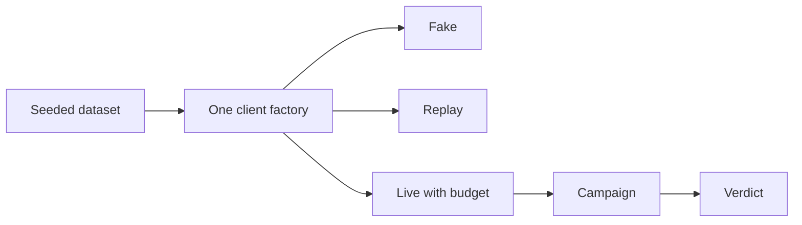

# SupportOps Foundation

<!-- case:start -->
## The case

- **Problem.** Independent services need one ticket, invoice and tool vocabulary, and an honest way to test a model against it.
- **Decision.** Strict Pydantic contracts, a seeded dataset with a digest, and one budget ledger across `fake`, `replay` and `live`. Budget is reserved before any provider call.
- **Measured.** A real-model development campaign: 27 of 36 trials passed, 9 of 12 unique cases passed all three trials (Wilson 95% interval 0.47 to 0.91). Verdict `FAIL_PROVISIONAL`. Source: `artifacts/evals/live/free-dev-c2r1/report.json`. The held-out budget (84 calls) and confirmation budget (60) were not touched.
- **Run it.** `uv sync --locked && uv run --locked python scripts/check_fast.py`
- **Limits.** The library gives contracts and fixtures. Fixtures are not model quality, and human review and promotion are still pending.
- **Docs.** [Architecture](docs/architecture.md), [decisions](docs/decisions).
<!-- case:end -->

<!-- flow:start -->
## How it works

Generated from the same data as the diagram on the portfolio site (`projects/foundation/`), so the two cannot drift.


<!-- flow:end -->

SupportOps Foundation is a versioned Python library containing domain models, deterministic datasets, a testkit, and provider-neutral LLM contracts for the independent SupportOps projects.

Current contract release: **1.0.1**. Consumers should record the source commit and wheel SHA-256 when installing a local artifact.

## Problem

Independent SupportOps services need the same ticket, customer, invoice, tool, and triage vocabulary. Copying those types into every service makes contract drift easy to miss.

## Architecture

The package has three boundaries: strict Pydantic domain models, a seeded deterministic testkit, and fake/replay/live LLM interfaces. Consumers install a versioned wheel rather than importing a sibling repository.

## Quickstart

Requirements: Python 3.13 and uv 0.12.7.

```powershell
uv sync --locked
$env:LLM_MODE = "fake"
uv run --locked python scripts/check_full.py
uv run --locked python demo/foundation_demo.py
```

## How it works

`supportops_foundation.domain` exports strict Pydantic models for customers, tickets, invoices, knowledge articles, tool calls/results, agent runs, and triage decisions. Unknown fields are rejected. Ticket timestamps require a timezone; invoice amounts must be positive. Public contract changes require an ADR, a package version update, and consumer upgrades.

`generate_dataset(seed=42)` creates deterministic customers, tickets, invoices, KB articles, and a golden set. The dataset's canonical JSON and SHA-256 digest make fixture changes reviewable. Golden examples are test fixtures, not model-quality measurements.

## LLM modes

- `fake` is deterministic and is the default in tests and CI.
- `replay` reads tracked JSONL cassettes in order and fails on request mismatch or cassette exhaustion. Cassettes may contain sensitive prompts; sanitize and review before tracking them.
- `live` is opt-in and requires `LLM_BASE_URL`, `LLM_API_KEY`, positive `LAB_MAX_USD`, an explicit model, and caller-supplied verified token rates. Budget is reserved before transport. Tests inject a transport and never contact a provider.

To add a cassette, write one JSON object per line with exact `request` and `response` objects matching `tests/fixtures/replay/hello.jsonl`. Record the source run and a redaction review beside non-fixture cassettes. Do not record live calls without the user's explicit budget authorization.

## Local services

`docker-compose.base.yml` describes Postgres with pgvector, Redis, and LocalStack for future integration exercises. Start them only when Docker is available and needed:

```powershell
docker compose -f docker-compose.base.yml up -d
uv run --locked python scripts/doctor.py
```

`doctor.py` reports actual local availability. Compose parsing is not an E2E service check.

## Testing

```powershell
uv run --locked python scripts/check_fast.py
uv run --locked python scripts/check_full.py
uv run --locked python scripts/doctor.py
```

Do not change golden-set expectations to make tests pass. Update the dataset seed, expected behavior, and digest together, then review the diff. Model quality, provider cost, and live latency remain **PENDING** until real authorized runs are recorded.

## Results

Current offline gate evidence is in `artifacts/evidence/live-campaign-execution/check-full.txt`. Broad model quality and human review remain **INCOMPLETE**; historical small provider smoke tests do not establish broad readiness.

## Design decisions

Unknown fields fail validation, fixtures use a stable seed and digest, and local consumers record wheel provenance. These choices make a contract change visible before it reaches another project.

## Limitations

The library provides contracts and test fixtures. It does not claim provider quality, production latency, or live cost measurements.

## Free-only campaign CLI

The local synthetic campaign uses the lab's shared Groq free-account guard, finite request/token ceilings and USD 0 paid authorization. Start with the credential-free inventory:

```powershell
python -S scripts/run_live_campaign.py --stage pilot --dry-run
$env:LLM_MODE="live"
uv run --locked python scripts/run_live_campaign.py --stage pilot --campaign-id free-pilot-v1 --execute-free --max-trials 6
uv run --locked python scripts/run_live_campaign.py --resume free-pilot-v1 --execute-free
```

Chunks contain at most ten new trials. Completed failures never replay; uncertain work requires reconciliation. Reports and immutable manifests live under `artifacts/evals/live/<campaign-id>/`. Sanitized artifacts reference provider usage receipts and private synthetic review-application state outside Git/artifacts. Exit 0/1 describes provisional engineering pass/fail; exit 2 means missing prerequisites, interrupted work or resource checkpoint. Human review and promotion remain separate pending gates; fake stays default.
